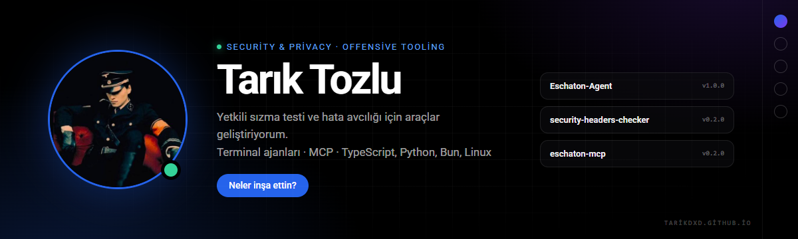
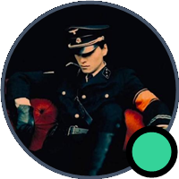

  

 **Tarık Tozlu** · şimdi

Yetkili sızma testi ve hata avcılığı için araçlar geliştiriyorum. Terminal ajanları, ağ araçları, MCP entegrasyonları ve otomasyon üzerine çalışıyorum.

Eschaton LTD. · Türkçe açık kaynak · TypeScript, Python, Bun, Linux

 **Tarık** · şimdi

- **[Eschaton-Agent](https://github.com/Tarikdxd/Eschaton-Agent)** `v1.0.0` — yetkili sızma testi ve kod yazma için insan denetimli terminal ajanı. Türkçe arayüz, 36 beceri, MCP ve izin akışı.
- **[security-headers-checker](https://github.com/Tarikdxd/security-headers-checker)** `v0.2.0` — CSP/HSTS/CORS/çerez denetimi, puanlama, SARIF ve GitHub Action.
- **[eschaton-mcp](https://github.com/Tarikdxd/eschaton-mcp)** `v0.2.0` — nmap, httpx, ffuf, sqlmap ve nuclei için kapsam zorlamalı MCP sunucusu.
- **[Eschaton-DNS](https://github.com/Tarikdxd/Eschaton-DNS)** — DNS-over-HTTPS proxy ve telemetri/reklam engelleyici; canlı terminal TUI.
- **[Eschaton-Tunnel](https://github.com/Tarikdxd/Eschaton-Tunnel)** — sıfır yapılandırmalı yerel HTTP/TCP tüneli; ngrok alternatifi.
- **[awesome-turkish-security](https://github.com/Tarikdxd/awesome-turkish-security)** — Türkçe güvenlik kaynakları; linkler CI ile doğrulanıyor.
- **[Discord-Token-Manager](https://github.com/Tarikdxd/Discord-Token-Manager)** — çok hesaplı Discord masaüstü yönetim paneli.

 **Tarık** · şimdi

Açık kaynakta başkalarının repolarına da dokunuyorum:

- **[airlock #108](https://github.com/airlock-sec/airlock/pull/108)** — yazılamayan manifest/rapor yolunu exit 2 kullanım hatası yapar. **Merge edildi.**
- **[ffuf #964](https://github.com/ffuf/ffuf/pull/964)** — dar terminalde progress satırının taşmasını düzeltir. **Tüm CI kontrolleri yeşil.**
- **[trufflehog #5499](https://github.com/trufflesecurity/trufflehog/pull/5499)** — README'ye içindekiler tablosu ekler. **CLA imzalandı; kontroller yeşil.**
- **[gitleaks #2332](https://github.com/gitleaks/gitleaks/pull/2332)** — SourceGraph çok satırlı token vakası için regresyon testi. İncelemede.

 **Tarık** · şimdi

Günlük akışımda ağırlıklı olarak:

  
  
  
  
  
  
  
  

 **Tarık** · şimdi

Rakamlarla:

  
  

Daha fazla grafik: [tarikdxd.github.io](https://tarikdxd.github.io)

 **Tarık** · şimdi

Proje fikirleri, güvenlik bildirimleri veya iş birliği için buradayım:

  
  
  
  

Yalnızca yetkili sistemlerde test yapın. Yetkisiz erişim suçtur.

