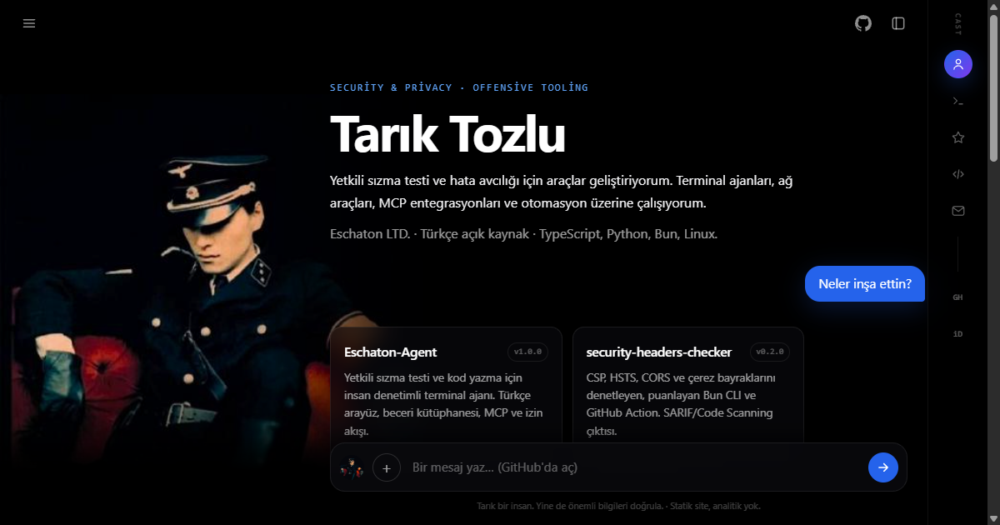

  

<table>
  <tr>
    <td width="52" valign="top"></td>
    <td valign="top">
      <strong>Tarık Tozlu</strong> · şimdi 
      Yetkili sızma testi ve hata avcılığı için araçlar geliştiriyorum. Terminal ajanları, ağ araçları, MCP entegrasyonları ve otomasyon üzerine çalışıyorum. 
      Eschaton LTD. · Türkçe açık kaynak · TypeScript, Python, Bun, Linux
    </td>
  </tr>
</table>

<table>
  <tr>
    <td width="52" valign="top"></td>
    <td valign="top">İşte üzerinde çalıştığım projeler:</td>
  </tr>
</table>

| Proje | Ne yapar |
| --- | --- |
| **[Eschaton-Agent](https://github.com/Tarikdxd/Eschaton-Agent)** `v1.0.0` | Yetkili sızma testi ve kod yazma için insan denetimli terminal ajanı. Türkçe arayüz, 36 beceri, MCP ve izin akışı. |
| **[security-headers-checker](https://github.com/Tarikdxd/security-headers-checker)** `v0.2.0` | CSP/HSTS/CORS/çerez denetimi, puanlama, SARIF ve GitHub Action. |
| **[eschaton-mcp](https://github.com/Tarikdxd/eschaton-mcp)** `v0.2.0` | nmap, httpx, ffuf, sqlmap ve nuclei için kapsam zorlamalı MCP sunucusu. |
| **[Eschaton-DNS](https://github.com/Tarikdxd/Eschaton-DNS)** | DNS-over-HTTPS proxy ve telemetri/reklam engelleyici; canlı terminal TUI. |
| **[Eschaton-Tunnel](https://github.com/Tarikdxd/Eschaton-Tunnel)** | Sıfır yapılandırmalı yerel HTTP/TCP tüneli; ngrok alternatifi. |
| **[awesome-turkish-security](https://github.com/Tarikdxd/awesome-turkish-security)** | Türkçe güvenlik kaynakları; linkler CI ile doğrulanıyor. |
| **[Discord-Token-Manager](https://github.com/Tarikdxd/Discord-Token-Manager)** | Çok hesaplı Discord masaüstü yönetim paneli. |

<table>
  <tr>
    <td width="52" valign="top"></td>
    <td valign="top">Açık kaynakta başkalarının repolarına da dokunuyorum:</td>
  </tr>
</table>

- **[airlock #108](https://github.com/airlock-sec/airlock/pull/108)** — yazılamayan manifest/rapor yolunu exit 2 kullanım hatası yapar. **Merge edildi.**
- **[ffuf #964](https://github.com/ffuf/ffuf/pull/964)** — dar terminalde progress satırının taşmasını düzeltir. **Tüm CI kontrolleri yeşil.**
- **[trufflehog #5499](https://github.com/trufflesecurity/trufflehog/pull/5499)** — README'ye içindekiler tablosu ekler. **CLA imzalandı; kontroller yeşil.**
- **[gitleaks #2332](https://github.com/gitleaks/gitleaks/pull/2332)** — SourceGraph çok satırlı token vakası için regresyon testi. İncelemede.

<table>
  <tr>
    <td width="52" valign="top"></td>
    <td valign="top">Günlük akışımda ağırlıklı olarak:</td>
  </tr>
</table>

  
  
  
  
  
  
  
  

<table>
  <tr>
    <td width="52" valign="top"></td>
    <td valign="top">Rakamlarla: Her gün 03:17 UTC'de kendi repomda üretilen kartlar.</td>
  </tr>
</table>

  
  

  
  

  

<table>
  <tr>
    <td width="52" valign="top"></td>
    <td valign="top">Proje fikirleri, güvenlik bildirimleri veya iş birliği için buradayım:</td>
  </tr>
</table>

  
  
  
  

Yalnızca yetkili sistemlerde test yapın. Yetkisiz erişim suçtur.

