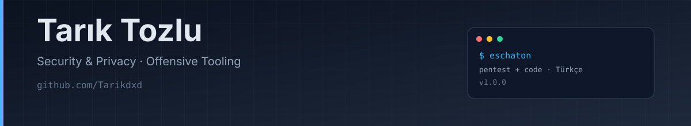

**Yetkili sızma testi, güvenlik araçları ve terminal ajanları geliştiriyorum.**
TypeScript · Python · Bun · Linux

---

## Hakkımda

- **Eschaton LTD.** çatısı altında yetkili sızma testi ve hata avcılığı için araçlar geliştiriyorum.
- Terminal ajanları, ağ araçları, MCP entegrasyonları ve otomasyon üzerine çalışıyorum.
- Türkçe açık kaynak: ürünlerin arayüzü ve dokümantasyonu öncelikli olarak Türkçe.
- **Security, privacy.** — yerel, denetlenebilir ve minimum veri toplayan tasarımlar.

## Öne çıkan projeler

| Proje | Ne yapar |
| --- | --- |
| **[Eschaton-Agent](https://github.com/Tarikdxd/Eschaton-Agent)** | Yetkili sızma testi ve kod yazma için insan denetimli terminal ajanı. Türkçe arayüz, beceri kütüphanesi, MCP desteği. |
| **[Eschaton-DNS](https://github.com/Tarikdxd/Eschaton-DNS)** | DNS-over-HTTPS proxy ve telemetri/reklam engelleyici; canlı terminal TUI. |
| **[Eschaton-Tunnel](https://github.com/Tarikdxd/Eschaton-Tunnel)** | Sıfır yapılandırmalı yerel HTTP/TCP tüneli; ngrok alternatifi. |
| **[security-headers-checker](https://github.com/Tarikdxd/security-headers-checker)** | CSP/HSTS/CORS denetleyen Bun CLI + GitHub Action. |
| **[eschaton-mcp](https://github.com/Tarikdxd/eschaton-mcp)** | nmap/httpx/ffuf/sqlmap için kapsam zorlamalı MCP sunucusu. |
| **[Discord-Token-Manager](https://github.com/Tarikdxd/Discord-Token-Manager)** | Çok hesaplı Discord masaüstü yönetim paneli. |

## GitHub istatistikleri

  
  

  
  

  

## Teknolojiler

  
  
  
  
  
  
  
  

## Şu an

- **Eschaton-Agent v1.0.0** — Türkçe arayüz, pentest + kod yazma becerileri, MCP ve insan denetimli izin akışı.
- **security-headers-checker v0.2.0** — SARIF/Code Scanning çıktılı başlık denetleyicisi.
- **eschaton-mcp v0.2.0** — nmap/httpx/ffuf/sqlmap + `nuclei_scan` için kapsam zorlamalı MCP köprüsü.
- **awesome-turkish-security** — Türkçe güvenlik kaynakları; katkıya açık.
- Yeni işlerde doğrudan `main` yerine **issue → branch → pull request → review** akışını kullanıyorum.

## Açık kaynak katkıları

- **[ffuf #964](https://github.com/ffuf/ffuf/pull/964)** — dar terminalde progress satırının taşmasını düzeltir; tüm CI kontrolleri yeşil.
- **[trufflehog #5499](https://github.com/trufflesecurity/trufflehog/pull/5499)** — README'ye içindekiler tablosu ekler.
- **[airlock #108](https://github.com/airlock-sec/airlock/pull/108)** — yazılamayan manifest/rapor yolunu exit 2 kullanım hatası olarak sınıflandırır. **Merge edildi.**
- **[gitleaks #2332](https://github.com/gitleaks/gitleaks/pull/2332)** — SourceGraph çok satırlı token vakası için regresyon testi.

## İletişim

- GitHub: [@Tarikdxd](https://github.com/Tarikdxd)
- Proje fikirleri ve güvenlik sorumluluğu: issue açmanız yeterli.

Yalnızca yetkili sistemlerde test yapın. Yetkisiz erişim suçtur.

